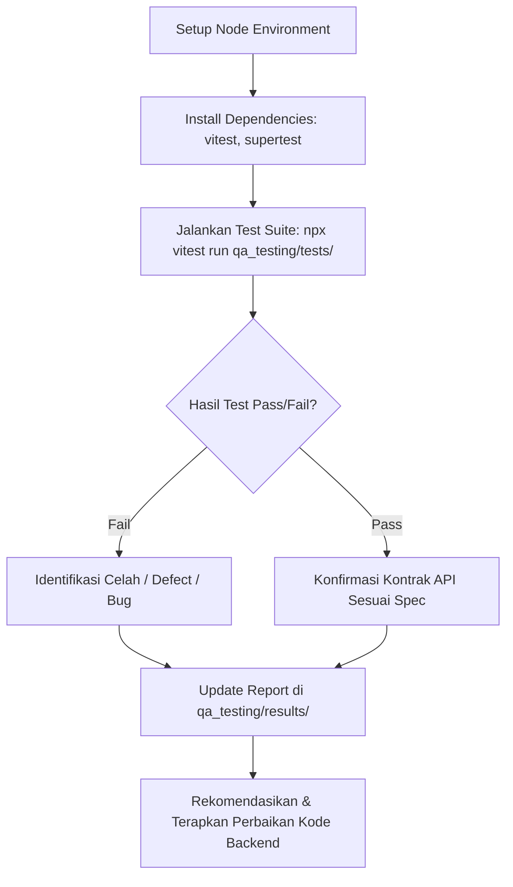

# 🧪 QA Testing Flow & Instructions — Backend API

Dokumen ini berisi panduan alur pengujian (*QA Testing Flow*), dependensi yang diperlukan, struktur pengujian, serta referensi repositori untuk backend `multimediamia-be`.

---

## 📌 1. Repositori & Referensi
* **Repository**: `multimediamia-be`
* **Branch Testing**: `QA-TEST/Liaurentino`
* **Stack**: Node.js (ES Module), Express.js (v5), Drizzle ORM, PostgreSQL / Neon DB, Vitest, Supertest.
* **Tujuan Testing**: Memvalidasi seluruh endpoint API berdasarkan standar **OWASP WSTG** (Web Security Testing Guide), **OWASP API Security Top 10:2023**, dan **Contract & Boundary Testing**.

---

## 📦 2. Dependensi yang Wajib Diinstal

Pengujian ini menggunakan framework `Vitest` dan library `Supertest` untuk HTTP Assertion tanpa perlu menjalankan server HTTP secara fisik.

### Install DevDependencies:
```bash
npm install --save-dev vitest supertest jsonwebtoken
```

### Daftar Library Penting:
| Library | Fungsi |
|---|---|
| `vitest` | Runner pengujian cepat berbasis ES Module |
| `supertest` | Library HTTP assertions untuk menguji endpoint Express `app.js` |
| `jsonwebtoken` | Generator token JWT untuk mensimulasikan role (User, Juri, Admin) |

---

## 🚀 3. Cara Menjalankan QA Test

### A. Jalankan Seluruh Suite QA Testing
```bash
npx vitest run qa_testing/tests/
```
atau menggunakan NPM script yang sudah terdaftar di `package.json`:
```bash
npm test
```

### B. Jalankan Test File Spesifik
```bash
npx vitest run qa_testing/tests/01_auth.test.js
npx vitest run qa_testing/tests/02_authorization.test.js
npx vitest run qa_testing/tests/03_input_validation.test.js
npx vitest run qa_testing/tests/04_business_logic.test.js
npx vitest run qa_testing/tests/05_api_config_errhandling.test.js
```

### C. Mode Watch (Auto-re-run saat file berubah)
```bash
npx vitest qa_testing/tests/
```

---

## 📂 4. Structure & Categorization Test Suite

Direktori `qa_testing/tests/` disusun secara modular dan terstruktur:

```
qa_testing/
├── FLOW.md                           # Dokumentasi alur & petunjuk QA
├── agenttesting.md                   # Panduan AI Agent untuk eksekusi QA
├── results/
│   └── 01_test_results.md            # Laporan hasil pengujian & defect log
└── tests/
    ├── 01_auth.test.js               # OWASP WSTG-ATHN: Authentication & OTP
    ├── 02_authorization.test.js      # OWASP WSTG-ATHZ: BOLA, BFLA, Role Access
    ├── 03_input_validation.test.js   # OWASP WSTG-INPV: SQLi, XSS, Payload Limits
    ├── 04_business_logic.test.js     # OWASP WSTG-BUSL: Workflow & Race Conditions
    └── 05_api_config_errhandling.test.js # OWASP WSTG-ERR/CONF: Errors & Pagination
```

---

## 🔄 5. Execution & Reporting Flow



1. **Jalankan Test Suite**: Eksekusi seluruh skenario pengujian unit/integration.
2. **Analisis Output**: Catat status HTTP response, error code, serta kecocokan payload.
3. **Catat Defect**: Dokumentasikan setiap kegagalan (*FAIL*) ke dalam laporan `qa_testing/results/`.
4. **Perbaiki Kode**: Lakukan patch pada controller/route backend untuk memperbaiki celah yang ditemukan.
